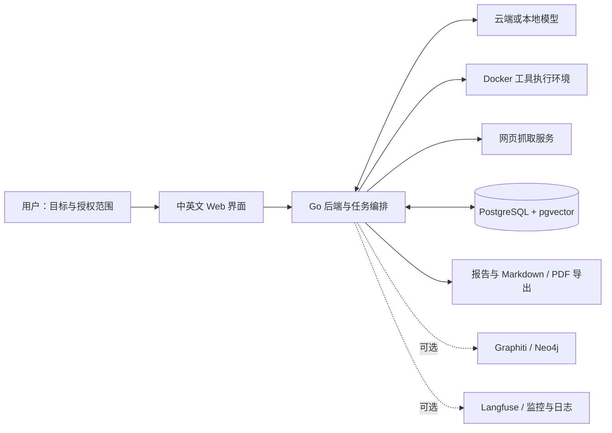

# pent-zh

**基于 [PentAGI](https://github.com/vxcontrol/pentagi) 的中文增强版 AI 安全测试平台，支持中英文界面、自托管部署、多智能体协作和报告导出。**

通过自然语言描述测试目标与任务，由智能体规划步骤、调用工具、整理证据并生成报告。项目保留上游的模型接入、任务执行与可观测能力，并加入中文使用体验、后台作业管理和报告增强。

> 仅用于获得明确授权的安全测试、教学与研究。执行任务前，请明确目标范围、允许的操作和停止条件。

[快速开始](#快速开始) · [模型配置](#模型配置) · [使用流程](#使用流程) · [开发与验证](#开发与验证) · [文档索引](#文档索引)

## 项目定位

本仓库是 PentAGI 的衍生版本，原项目由 [VXControl](https://vxcontrol.com) 开发。应用内部名称、环境变量和容器名称沿用 `pentagi`，仓库名称为 `pent-zh`。

| 能力 | 说明 |
| --- | --- |
| 中英文界面 | 登录页与应用顶部可切换中文 / English，选择保存在当前浏览器 |
| 多智能体协作 | 支持自主执行与交互助手，跟踪任务、子任务和工具调用 |
| 多模型接入 | 支持云端模型、OpenAI 兼容接口，以及 Ollama 等本地模型服务 |
| 后台作业管理 | 支持作业状态、失败重试、重启恢复，以及同一流程内的作业排序 |
| 流程回收站 | 支持删除、恢复和永久删除流程 |
| 报告与导出 | 支持流程和交互会话报告、Markdown / PDF 导出及中文 PDF 排版 |
| 过程留存 | 保存终端记录、工具输出、文件、截图和向量记忆 |
| 知识与资源 | 管理知识库、任务模板和可供流程使用的资源文件 |
| 可选扩展 | Graphiti / Neo4j 知识图谱、Langfuse 模型调用追踪、监控与日志组件 |
| 自动化接口 | 提供 REST、GraphQL 和 API 令牌，便于与其他系统集成 |

界面语言不会翻译已有任务或报告；生成内容的语言由任务输入和提示词决定。安全测试结果需要人工复核，模型输出不能直接视为已确认的漏洞。

## 系统组成



基础 Compose 包含 `pentagi`、`pgvector`、`scraper` 和 `pgexporter`。工具任务会按需使用额外的执行容器。

## 快速开始

### 1. 准备环境

- Docker Engine 或 Docker Desktop，支持 Linux 容器，并安装 Docker Compose v2。
- 可访问所需容器镜像、模型服务和依赖下载源的网络环境。
- 至少一个支持工具调用的模型服务；向量记忆还需要可用的 Embedding 服务。
- 使用下文完整 Docker 构建时，无需在宿主机另装 Node.js 或 Go。

建议为基础服务准备至少 4 核 CPU、8 GB 内存和 30 GB 可用磁盘，并按并发量、镜像数量与数据规模增加资源。完整源码构建、本地模型和可选扩展需要更多资源。

### 2. 获取项目

```bash
git clone https://github.com/meltsnowman9527/pent-zh.git
cd pent-zh
```

复制环境配置。已有 `.env` 时请保留原配置，不要覆盖。

Windows PowerShell：

```powershell
Copy-Item .env.example .env
```

Linux / macOS：

```bash
cp .env.example .env
```

### 3. 配置服务

编辑 `.env`，完成以下设置：

| 配置项 | 用途 |
| --- | --- |
| 模型服务相关变量 | 配置模型地址、密钥和模型名称，见[模型配置](#模型配置) |
| `EMBEDDING_*` | 配置向量模型及其服务地址、认证方式 |
| `COOKIE_SIGNING_SALT` | 将示例值替换为随机长字符串 |
| `PENTAGI_POSTGRES_PASSWORD` | 为新部署设置数据库密码 |
| `LOCAL_SCRAPER_USERNAME` / `LOCAL_SCRAPER_PASSWORD` | 设置抓取服务凭据，并同步更新 `SCRAPER_PRIVATE_URL` 中的认证信息 |
| `PUBLIC_URL` / `CORS_ORIGINS` | 填写浏览器实际访问的地址，协议和端口需要一致 |
| `PENTAGI_LISTEN_IP` / `PENTAGI_LISTEN_PORT` | 控制宿主机监听地址和端口，默认仅本机 `127.0.0.1:8443` |

默认使用 `https://localhost:8443`。若仅在本机使用 HTTP，请设置：

```dotenv
SERVER_USE_SSL=false
PUBLIC_URL=http://localhost:8443
CORS_ORIGINS=http://localhost:8443
PENTAGI_LISTEN_IP=127.0.0.1
PENTAGI_LISTEN_PORT=8443
```

已有数据库的密码变更需要同步修改数据库账号密码，仅改 `.env` 不会改变现有数据卷中的密码。

### 4. 构建本仓库版本

**要使用本仓库的中文增强功能，必须构建当前源码。** `.env.example` 默认指向上游镜像 `vxcontrol/pentagi:latest`，该镜像不包含本仓库的本地修改。

在项目根目录运行：

```bash
docker build -t pent-zh:local .
```

构建完成后，将 `.env` 中的镜像设置为：

```dotenv
PENTAGI_IMAGE=pent-zh:local
```

### 5. 启动与登录

```bash
docker compose config --quiet
docker compose up -d
docker compose ps
```

按所选协议访问 [HTTPS 入口](https://localhost:8443) 或 [HTTP 入口](http://localhost:8443)。新安装的默认账号为 `admin@pentagi.com`，默认密码为 `admin`；首次登录后立即修改。已有部署沿用原账号和密码。

默认 HTTPS 使用自签证书，浏览器可能提示证书不受信任。对外部署时请配置可信证书或 HTTPS 反向代理。

## 模型配置

项目支持 OpenAI、Anthropic、Gemini、AWS Bedrock、DeepSeek、GLM、Kimi、Qwen、MiniMax、Mistral、xAI，以及 Ollama 和自定义模型服务。完整变量说明见 [后端配置参考](backend/docs/config.md) 与 [.env.example](.env.example)。

以下为接入方式示例，请将占位值替换为真实服务配置。

### OpenAI 兼容服务

```dotenv
LLM_SERVER_URL=https://your-model-service.example/v1
LLM_SERVER_KEY=your-api-key
LLM_SERVER_MODEL=your-tool-capable-model
```

需要按智能体角色分配模型或调整推理参数时，参考 [模型配置示例](examples/configs)。`PENTAGI_LLM_SERVER_CONFIG_PATH` 控制宿主机挂载文件，`LLM_SERVER_CONFIG_PATH` 则指向容器内的配置路径；两者用途不同。

### Ollama

Docker Desktop 上可通过以下地址访问宿主机 Ollama，需确保服务允许容器连接：

```dotenv
OLLAMA_SERVER_URL=http://host.docker.internal:11434
OLLAMA_SERVER_MODEL=your-tool-capable-model
```

Linux 环境请使用容器可达的宿主机或模型服务地址。容器内的 `localhost` 指向容器自身。

### 向量模型

聊天模型与 Embedding 模型分别配置。根据所选服务设置 `EMBEDDING_PROVIDER`、`EMBEDDING_URL`、`EMBEDDING_KEY` 和 `EMBEDDING_MODEL`，并确认服务支持向量接口。

修改 `.env` 后，执行 `docker compose up -d` 使容器配置生效。模型连通后，可在 Web 的模型提供商设置中检查配置，再创建任务。

## 使用流程

1. 登录并修改默认密码，选择界面语言。
2. 检查模型提供商，准备任务所需的知识、模板与资源文件。
3. 新建流程，写明目标、授权范围、任务目标及限制条件。
4. 选择自主执行或交互助手，在流程详情中查看任务、终端、工具和文件。
5. 根据执行结果补充指令、停止任务或重试失败作业。
6. 复核证据与结论，生成报告并导出 Markdown 或 PDF。

删除的流程可在回收站恢复；永久删除前请确认所需报告与证据已经导出。

## 更新与运维

### 完整源码构建

拉取并审阅新代码后，重新构建镜像并更新服务：

```bash
docker build -t pent-zh:local .
docker compose up -d
```

### Windows 本地快速更新

仓库提供复用上游运行环境的更新脚本。先安装 `frontend/package.json` 指定版本的 pnpm、使用 `frontend/.nvmrc` 指定版本的 Node.js，并安装前端依赖：

```powershell
Push-Location frontend
pnpm install --frozen-lockfile
Pop-Location
docker pull vxcontrol/pentagi:latest
.\scripts\update.ps1
```

脚本构建前端，通过 `Dockerfile.local` 运行后端相关测试并编译，生成 `pentagi-local:latest`，更新 `.env` 的镜像设置，再部署到名为 `pentagi` 的 Compose 项目。执行前请确认这就是需要更新的部署项目。

辅助命令行工具和运行依赖复用上游镜像；这些部分发生变化时，应使用完整 `Dockerfile` 构建。已有经过验证的本地镜像时，可执行 `.\scripts\update.ps1 -DeployOnly`。

### 常用维护命令

```bash
docker compose ps
docker compose logs --tail 100 pentagi
docker compose stop
docker compose start
```

更新前请自行备份数据库及持久化数据；更新脚本不会自动备份。不要使用 `docker compose down -v` 进行常规更新，该命令会删除 Compose 管理的数据卷。

### 可选组件

| 功能 | Compose 文件 |
| --- | --- |
| 模型调用追踪 | [docker-compose-langfuse.yml](docker-compose-langfuse.yml) |
| 系统指标、日志与链路追踪 | [docker-compose-observability.yml](docker-compose-observability.yml) |
| Graphiti / Neo4j 知识图谱 | [docker-compose-graphiti.yml](docker-compose-graphiti.yml) |

按 [.env.example](.env.example) 和对应文件配置依赖、密码、路径与端口后，再与基础 Compose 组合启用。Graphiti 的安装与配置还可参考[上游部署说明](https://github.com/vxcontrol/pentagi#knowledge-graph-integration-graphiti)。

## 开发与验证

前端使用 React 19、TypeScript、Vite 和 Tailwind CSS；后端使用 Go、Gin 和 GraphQL，数据存储使用 PostgreSQL / pgvector。

工具链版本以 `frontend/.nvmrc`、`frontend/package.json` 和 `backend/go.mod` 为准，当前分别为 Node.js `24.17.0`、pnpm `11.8.0` 和 Go `1.26.5`。

前端检查：

```bash
cd frontend
pnpm install --frozen-lockfile
pnpm test
pnpm build
```

后端检查（在 `backend` 目录运行）：

```bash
go test ./pkg/controller ./pkg/reports ./pkg/graph ./pkg/server/services ./pkg/database
```

部分后端测试依赖 CGO / SQLite；Windows 上需要支持 CGO 的 C 编译环境，或在 Linux / 构建容器中执行。`Dockerfile.local` 已包含相关包的竞态测试。

## 目录结构

```text
backend/                  Go 后端、智能体、API、数据库迁移与命令行工具
frontend/                 Web 界面、中英文资源与前端测试
examples/                 模型配置、部署示例与工作节点指南
scripts/                  本地更新与维护脚本
observability/            监控、日志与链路追踪配置
licenses/                 第三方依赖许可信息
docker-compose*.yml       基础服务与可选扩展
Dockerfile                从源码构建完整应用镜像
Dockerfile.local          复用上游运行环境的本地构建
.env.example              环境配置模板
```

## 数据与部署安全

- `.env`、真实密钥、账号文件、证书私钥和运行数据仅保留在本机，不随源码上传。
- Docker 工具容器需要明确的权限边界。挂载宿主机 Docker Socket 会授予很高权限，生产部署建议使用独立工作节点，参考[工作节点指南](examples/guides/worker_node.md)。
- `DOCKER_INSIDE=true` 会进一步向工具容器开放 Docker 访问；启用前请确认任务确有需要。
- 对外服务应使用 HTTPS、强密码和访问控制，并限制数据库与监控端口的暴露范围。
- 报告、日志、截图和向量记忆可能包含测试目标的敏感信息，请按授权要求管理、备份和删除。

## 文档索引

- [后端配置参考](backend/docs/config.md)
- [流程执行与智能体编排](backend/docs/flow_execution.md)
- [模型配置示例](examples/configs)
- [独立工作节点部署](examples/guides/worker_node.md)
- [vLLM + Qwen 本地模型部署](examples/guides/vllm-qwen35-27b-fp8.md)
- [本地功能与上游整合记录](docs/LOCAL_UPSTREAM_SYNC.md)
- [本机历史部署与更新记录](DEPLOYMENT.md)（历史记录中的地址、镜像和状态以实际环境为准）
- [贡献指南](CONTRIBUTING.md)
- [上游项目与完整使用说明](https://github.com/vxcontrol/pentagi)

## 许可证与致谢

本项目基于 PentAGI，保留原作者及贡献者的署名与许可声明，核心项目采用 [MIT License](LICENSE)。其他条款与第三方组件信息见 [EULA.md](EULA.md)、[NOTICE](NOTICE) 和 [licenses/](licenses)。VXControl Cloud 服务的访问可能需要单独的许可与服务条款。

感谢 [PentAGI](https://github.com/vxcontrol/pentagi)、VXControl 以及所有上游和本地贡献者。
